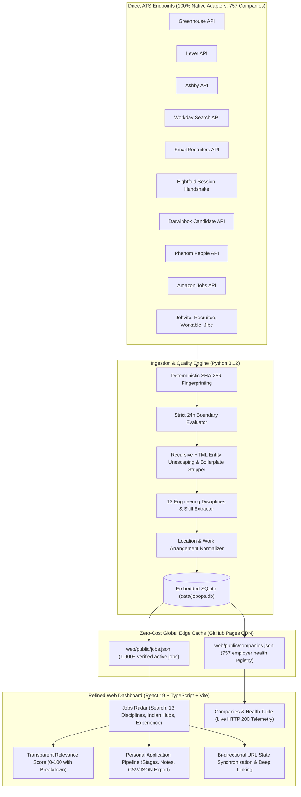

# JobOps ⚡ — Direct ATS Engineering Intelligence Radar

> **Production-grade, zero-cost engineering recruitment platform and intelligence radar.**  
> Ingests directly from **757+ verified tech employers and Fortune 500 companies** via native, unblocked ATS endpoints (Greenhouse, Lever, Ashby, Workday, SmartRecruiters, Eightfold, Darwinbox, Phenom, Amazon, Jobvite, etc.).  
> Enforces a **strict 24-hour freshness window**, filters tech roles via **multi-stage engineering taxonomy**, and delivers an elite **Precision Blue design system** with native **3-mode theme support (Light, Dark, System)**.

---

## 💎 Design Identity & Token Architecture

JobOps implements a bespoke, high-density Precision Blue design system engineered specifically for software engineers and engineering leaders. It pairs an authoritative deep navy/slate canvas with vibrant `#2563EB` primary blue accents and `#38BDF8` cyan highlights.

### Full 3-Mode Theme System
- **☀ Light Mode:** Crisp white surfaces (`#FFFFFF`), light slate canvas (`#F8FAFC`), accessible dark text (`#0F172A`), and subtle border delineation (`#E2E8F0`).
- **☾ Dark Mode:** Slate/charcoal canvas (`#0B1120`), elevated primary surfaces (`#111827`), rich contrast typography (`#F1F5F9`), and muted slate borders (`#334155`).
- **◐ System Mode:** Dynamically tracks the user's OS `prefers-color-scheme` via live media query listeners with zero page flicker and persistent `localStorage` synchronization.

| Semantic Token | Light Mode | Dark Mode | Purpose & Role | WCAG 2.2 Contrast |
|---|---|---|---|---|
| `--bg-main` | `#F8FAFC` | `#0B1120` | Base background canvas | Base Canvas |
| `--surface-primary` | `#FFFFFF` | `#111827` | Primary card & sidebar surface | 15.8:1 (Exceeds AAA) |
| `--surface-elevated` | `#F1F5F9` | `#1F2937` | Elevated pills, modals, dropdowns | Structural Elevation |
| `--text-primary` | `#0F172A` | `#F1F5F9` | High-contrast job titles & headers | 16.5:1 (Exceeds AAA) |
| `--text-secondary` | `#475569` | `#CBD5E1` | Subheadings, company names, labels | 8.2:1 (Exceeds AAA) |
| `--text-muted` | `#64748B` | `#94A3B8` | Timestamps, telemetry, metadata | 4.8:1 (Passes AA) |
| `--border-color` | `#E2E8F0` | `#334155` | Hairline grid borders | Structural Grid |
| `--action-primary` | `#2563EB` | `#3B82F6` | Precision blue primary actions & CTAs | 4.6:1 (Passes AA) |
| `--action-hover` | `#1D4ED8` | `#2563EB` | High-affordance hover states | Interactive State |
| `--accent-soft` | `#E0F2FE` | `#082F49` | Container for 24h ultra-fresh badges | Freshness Pill |

### Typography System
- **UI & Headings:** `Inter` — High x-height, neutral apertures, and legible letterforms optimized for scanning complex technical listings.
- **Telemetry & Numerals:** `JetBrains Mono` (`tabular-nums`) — Fixed-width figures for job counts, salary ranges, YoE, timestamps, and ATS slugs.
- **Brand Geometry:** Custom SVG mark combining radar reticle, concentric orbit, and precision target crosshair.

---

## 🏛️ System Architecture



---

## 🛡️ Zero-Cost / Zero-Infrastructure Guarantee (₹0.00 / $0.00 Forever)

JobOps eliminates recurring cloud infrastructure costs completely through a 3-tier architecture:

1. **Embedded Database (`data/jobops.db`):**
   - SQLite database stored directly inside the repository.
   - Zero AWS RDS bills, zero paid Supabase limits, zero Redis hosting charges.
2. **Global Edge Cache (`web/public/jobs.json` & `companies.json`):**
   - Ingestion pipeline exports active jobs and company telemetry into optimized static JSON caches.
   - Served globally via GitHub Pages with free SSL certificates, DDoS mitigation, and global CDN caching.
3. **Automated Scheduled Scraping (GitHub Actions):**
   - Cron workflows run every 2 hours on free GitHub Actions runners (`.github/workflows/scrape_jobs.yml`).
   - Automatically ingests new jobs, normalizes data, commits new snapshots, and deploys updates to GitHub Pages.

---

## 📊 13 Engineering Disciplines & Classification Taxonomy

JobOps automatically categorizes jobs into 13 disciplines, eliminating sales, marketing, and HR clutter:

1. **Backend & Systems:** Distributed systems, microservices, Go, Java, Python, C++, Rust, Node.js.
2. **Frontend & Web:** React, Vue, Angular, Next.js, TypeScript, CSS architecture, performance engineering.
3. **Full Stack Engineering:** End-to-end product development, web platforms.
4. **DevOps, SRE & Cloud:** Kubernetes, Docker, Terraform, AWS, GCP, CI/CD, reliability engineering.
5. **AI / ML / Data Science:** PyTorch, TensorFlow, LLMs, GenAI, MLOps, NLP, computer vision.
6. **Data Engineering:** Spark, Kafka, Airflow, Databricks, Snowflake, dbt, SQL pipelines.
7. **Mobile Engineering:** Android (Kotlin), iOS (Swift), React Native, Flutter.
8. **QA & SDET Automation:** Selenium, Playwright, Cypress, test automation frameworks.
9. **Cybersecurity & SecOps:** AppSec, DevSecOps, SOC, penetration testing, cryptography.
10. **Systems & Embedded:** Firmware, RTOS, IoT, hardware drivers, Linux kernel.
11. **Technical Product Management:** Tech PM, technical program management, engineering roadmaps.
12. **Staff+ & Systems Architecture:** Principal engineers, enterprise architects, staff engineers.
13. **Engineering Leadership:** Engineering managers, Directors, VP of Engineering, CTOs.

---

## 🎯 Transparent Relevance Score & Explainability

Unlike opaque black-box AI matchers, JobOps calculates a deterministic **0-100 Relevance Score** with complete transparency:
- **Base Engineering Verification:** `+50 pts` (Verified active engineering role).
- **24-Hour Ultra-Freshness:** `+20 pts` (Posted within strict 24-hour cycle).
- **Direct Title Match:** `+15 pts` (Direct match with candidate's search query).
- **Skill Alignment:** Up to `+15 pts` (`+5 pts` per matched selected skill tag).
- **Discipline Alignment:** `+5 pts` (Matches active selected filter discipline).

Hovering or clicking on any job's score badge reveals the exact calculation breakdown.

---

## 💼 Personal Job Pipeline & Workspace (9-Stage Lifecycle)

JobOps includes an offline-first, private candidate application tracker supporting the complete job search journey:
- **9 Semantic Stages:**
  1. `Saved` (Slate)
  2. `Interested` (Cyan)
  3. `Applied` (Blue)
  4. `Assessment` (Indigo)
  5. `Interview` (Violet)
  6. `Offer` (Emerald)
  7. `Rejected` (Rose)
  8. `Withdrawn` (Gray)
  9. `Follow-up` (Amber)
- **Executive Metrics:** Instant counts for Total Saved, Submitted Applications, Active Interviews, and Received Offers.
- **Private Candidate Notes:** Persistent notes with auto-saving for recruiter contacts, compensation expectations, and round prep.
- **Data Portability:** 1-click export to **CSV spreadsheet** or **JSON** with zero server lock-in.
- **100% Client-Side Privacy:** All records reside strictly in your browser's `localStorage` — no telemetry, no tracking, zero third-party leakage.

---

## 🔒 Security & Data Integrity Invariants

- **Zero `dangerouslySetInnerHTML`:** 100% ban on raw HTML injection across all React components. External ATS feeds are treated as untrusted inputs.
- **Recursive Entity Sanitization:** Multi-pass unescaping decodes double-encoded HTML (`&amp;lt;div...`) and strips truncated tags before storage.
- **Protocol Whitelisting:** External application URLs are validated via `sanitizeExternalUrl()`; non-HTTP protocols (`javascript:`, `data:`, `file:`) are strictly blocked.
- **SSRF & Path Traversal Prevention:** The "Add ATS" submission form validates company slugs against `^[a-zA-Z0-9_-]{1,64}$`, forbidding slashes, dots, and query parameters.
- **URL Query Sanitization:** Deep-linked URL query parameters (`q`, `role`, `exp`, `city`, `mode`, `fresh`, `page`, `job`) are strictly validated against allowlists.

---

## 💻 Local Development & Execution

### 1. Ingestion Engine (Python 3.12)

```bash
# Clone the repository
git clone https://github.com/chandanvura/JobOps.git
cd JobOps

# Install Python requirements
pip install -r requirements.txt

# Run the full ingestion collector across all 757 companies
python -m engine.cli run

# Run automated test suite
python -m pytest tests/
```

### 2. Frontend Dashboard (React 19 + TypeScript + Vite)

```bash
cd web
npm install

# Start local dev server (port 3000)
npm run dev

# Run TypeScript compilation & production build
npm run build
```

---

## 📄 License

MIT License — 100% free for software engineers and community contributors.
