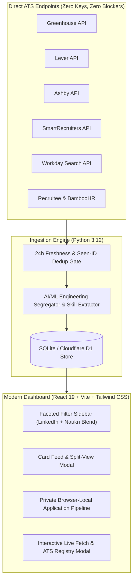

# JobOps ⚡

> **Next-generation, 100% free engineering job intelligence platform for India.**  
> Scrapes native ATS endpoints (Greenhouse, Lever, Ashby, Workday, SmartRecruiters) directly with **zero overhead**, enforces a **strict 24-hour freshness window**, filters engineering disciplines via NLP/ML, and presents a modern **LinkedIn + Naukri-inspired dashboard**.

---

## 🚀 Key Advantages Over Traditional Job Boards

| Feature | JobOps | Traditional Scrapers / Boards |
|---|---|---|
| **Operating Cost** | **₹0.00 / $0.00 forever** | Paid scrapers, expensive proxy pools, paid cloud DBs |
| **Ingestion Method** | **Direct Public ATS JSON Endpoints** | Fragile DOM HTML scraping, cloudflare blocks |
| **Freshness Rule** | **Strict 24-hour window** | Stale jobs from weeks/months ago |
| **Deduplication** | **Deterministic SHA-256 Seen-Key Registry** | Continuous redundant scrapes & database re-writes |
| **Classification** | **2-Tier ML/NLP Engineering Segregation** | Keyword searching with HR/Sales clutter |
| **Filters** | **LinkedIn & Naukri Blend** (Roles, YoE, Hubs, Mode, Skills) | Basic text search or cluttered ads |
| **Community Trigger** | **Interactive On-Demand Fetch & Add ATS** | Static single-admin feeds |

---

## 🏛️ System Architecture



---

## 🛠️ Tech Stack

- **Ingestion & Collector:** Python 3.12 (`httpx`, `pydantic`, `selectolax`, `pytest`)
- **Classification & NLP:** Multi-stage engineering filter, context-aware experience parser, technology taxonomy
- **Frontend Dashboard:** React 19, TypeScript, Vite, Tailwind CSS, Lucide Icons
- **Storage:** Local SQLite & JSON export, deployable to Cloudflare D1 / Supabase free tier
- **CI / Automation:** GitHub Actions (scheduled every 3h + on-demand dispatch)

---

## 💻 Quick Start

### 1. Ingestion Engine (Python)

```bash
# Clone the repository
git clone https://github.com/chandanvura/JobOps.git
cd JobOps

# Install dependencies
pip install -r requirements.txt

# Run the ingestion pipeline (strictly 24-hour fresh jobs)
python -m engine.cli run

# Display catalog stats
python -m engine.cli stats

# Export to web catalog
python -m engine.cli export --output web/public/jobs.json
```

### 2. Web Dashboard (React + Vite)

```bash
cd web
npm install
npm run dev
# Dashboard opens on http://localhost:3000
```

### 3. Run Test Suite

```bash
pytest tests/
```

---

## 📜 Supported ATS Providers

- **Greenhouse:** `boards-api.greenhouse.io/v1/boards/{token}/jobs?content=true`
- **Lever:** `api.lever.co/v0/postings/{token}?mode=json`
- **Ashby:** `api.ashbyhq.com/posting-api/job-board/{token}?includeCompensation=true`
- **SmartRecruiters:** `api.smartrecruiters.com/v1/companies/{token}/postings`
- **Workday:** `POST wday/cxs/{tenant}/{site}/jobs`
- **Recruitee:** `api.recruitee.com/c/{company}/offers`
- **BambooHR:** `bamboohr.com/careers/list`

---

## 📄 License

MIT License — free for personal and commercial use.
