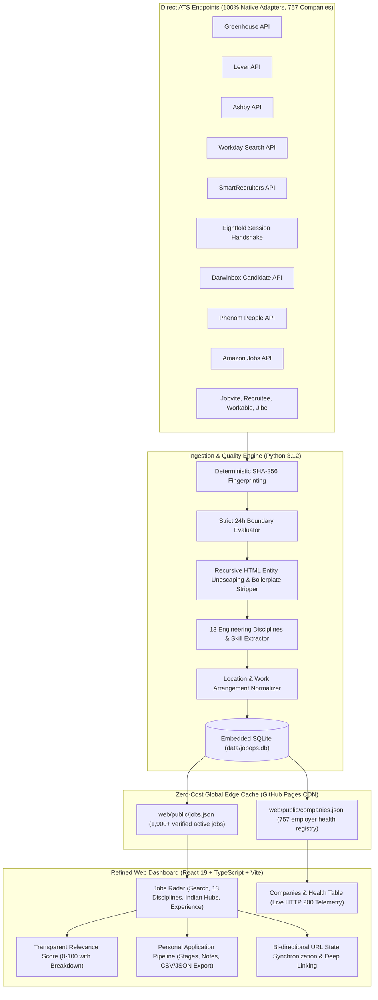

# JobOps ⚡ — Direct ATS Engineering Intelligence Radar

> **Production-grade, zero-cost engineering recruitment platform and intelligence radar.**  
> Ingests directly from **757+ verified tech employers and Fortune 500 companies** via native, unblocked ATS endpoints (Greenhouse, Lever, Ashby, Workday, SmartRecruiters, Eightfold, Darwinbox, Phenom, Amazon, Jobvite, etc.).  
> Enforces a **strict 24-hour freshness window**, filters tech roles via **multi-stage engineering taxonomy**, and delivers an elite **Precision Blue design system** with native **3-mode theme support (Light, Dark, System)**.

---

## 💎 Design Identity & Token Architecture

JobOps implements an elite, high-density design system refined according to the **`redesign-skill`** diagnostic principles. It pairs a pure `#000000` dark canvas and `#181818` card surfaces with precision blue accents (`#2563EB` / `#3B82F6`) and refined `#313131` borders.

### Full 3-Mode Theme System
- **☀ Light Mode:** Crisp white surfaces (`#FFFFFF`), light slate canvas (`#F8FAFC`), accessible dark text (`#0F172A`), and subtle border delineation (`#E2E8F0`).
- **☾ Dark Mode:** Approved neutral dark canvas (`#000000`), primary card surfaces (`#181818`), elevated modals & dropdowns (`#272727`), rich contrast typography (`#F1F5F9`), and hairline borders (`#313131`).
- **◐ System Mode:** Dynamically tracks the user's OS `prefers-color-scheme` via live media query listeners with zero page flicker and persistent `localStorage` synchronization.

| Semantic Token | Light Mode | Dark Mode | Purpose & Role | WCAG 2.2 Contrast |
|---|---|---|---|---|
| `--bg-main` | `#F8FAFC` | `#000000` | Base background canvas | Base Canvas |
| `--surface-primary` | `#FFFFFF` | `#181818` | Primary card & sidebar surface | 16.2:1 (Exceeds AAA) |
| `--surface-elevated` | `#FFFFFF` | `#272727` | Elevated pills, modals, dropdowns | Structural Elevation |
| `--text-primary` | `#0F172A` | `#F1F5F9` | High-contrast job titles & headers | 16.5:1 (Exceeds AAA) |
| `--text-secondary` | `#475569` | `#CBD5E1` | Subheadings, company names, labels | 8.2:1 (Exceeds AAA) |
| `--text-muted` | `#64748B` | `#94A3B8` | Timestamps, telemetry, metadata | 4.8:1 (Passes AA) |
| `--border-color` | `#E2E8F0` | `#313131` | Hairline grid borders | Structural Grid |
| `--action-primary` | `#2563EB` | `#3B82F6` | Primary action buttons & active indicators | 4.6:1 (Passes AA) |
| `--action-hover` | `#1D4ED8` | `#60A5FA` | High-affordance hover states | Interactive State |

### Typography System
- **UI & Headings:** `Geist` — Clean, high-legibility sans-serif with neutral apertures, tight tracking (`-0.011em`), and balanced line-wrapping (`text-wrap: balance`).
- **Telemetry & Numerals:** `Geist Mono` (`tabular-nums`) — Fixed-width figures for job counts, salary ranges, YoE, timestamps, and ATS slugs.
- **Hero Heading Gradient:** Text-only gradient (Dark: `#FFFFFF` $\rightarrow$ `#9B9B9B`; Light: `#000000` $\rightarrow$ `#666666`) capped at `max-w-[680px]`.
- **Floating Navigation Bar:** Floating slightly off the top edge (`sticky top-2 sm:top-3`) on a translucent blurred surface (`backdrop-blur-md`).
- **Tactile Micro-Interactions:** `active:scale-[0.98]` on buttons and cards with respect for `prefers-reduced-motion`.

---

## 🏛️ System Architecture



---

## 🛡️ Zero-Cost / Zero-Infrastructure Guarantee (₹0.00 / $0.00 Forever)

JobOps eliminates recurring cloud infrastructure costs completely through a 3-tier architecture:

1. **Embedded Database (`data/jobops.db`):**
   - SQLite database stored directly inside the repository.
   - Zero AWS RDS bills, zero paid Supabase limits, zero Redis hosting charges.
2. **Global Edge Cache (`web/public/jobs.json` & `companies.json`):**
   - Ingestion pipeline exports active jobs and company telemetry into optimized static JSON caches.
   - Served globally via GitHub Pages with free SSL certificates, DDoS mitigation, and global CDN caching.
3. **Automated Scheduled Scraping (GitHub Actions):**
   - Cron workflows run every 2 hours on free GitHub Actions runners (`.github/workflows/ingest.yml`).
   - Automatically ingests new jobs, normalizes data, commits new snapshots, and deploys updates to GitHub Pages.

---

## 📊 13 Engineering Disciplines & Classification Taxonomy

JobOps automatically categorizes jobs into 13 disciplines, eliminating sales, marketing, and HR clutter:

1. **Backend & Systems:** Distributed systems, microservices, Go, Java, Python, C++, Rust, Node.js.
2. **Frontend & Web:** React, Vue, Angular, Next.js, TypeScript, CSS architecture, performance engineering.
3. **Full Stack Engineering:** End-to-end product development, web platforms.
4. **DevOps, SRE & Cloud:** Kubernetes, Docker, Terraform, AWS, GCP, CI/CD, reliability engineering.
5. **AI / ML / Data Science:** PyTorch, TensorFlow, LLMs, GenAI, MLOps, NLP, computer vision.
6. **Data Engineering:** Spark, Kafka, Airflow, Databricks, Snowflake, dbt, SQL pipelines.
7. **Mobile Engineering:** Android (Kotlin), iOS (Swift), React Native, Flutter.
8. **QA & SDET Automation:** Selenium, Playwright, Cypress, test automation frameworks.
9. **Cybersecurity & SecOps:** AppSec, DevSecOps, SOC, penetration testing, cryptography.
10. **Systems & Embedded:** Firmware, RTOS, IoT, hardware drivers, Linux kernel.
11. **Technical Product Management:** Tech PM, technical program management, engineering roadmaps.
12. **Staff+ & Systems Architecture:** Principal engineers, enterprise architects, staff engineers.
13. **Engineering Leadership:** Engineering managers, Directors, VP of Engineering, CTOs.

---

## 🎯 Transparent Relevance Score & Explainability

Unlike opaque black-box AI matchers, JobOps calculates a deterministic **0-100 Relevance Score** with complete transparency:
- **Base Engineering Verification:** `+50 pts` (Verified active engineering role).
- **24-Hour Ultra-Freshness:** `+20 pts` (Posted within strict 24-hour cycle).
- **Direct Title Match:** `+15 pts` (Direct match with candidate's search query).
- **Skill Alignment:** Up to `+15 pts` (`+5 pts` per matched selected skill tag).
- **Discipline Alignment:** `+5 pts` (Matches active selected filter discipline).

Hovering or clicking on any job's score badge reveals the exact calculation breakdown.

---

## 💼 Personal Job Pipeline & Workspace (9-Stage Lifecycle)

JobOps includes an offline-first, private candidate application tracker supporting the complete job search journey:
- **9 Semantic Stages:**
  1. `Saved` (Slate)
  2. `Interested` (Cyan)
  3. `Applied` (Blue)
  4. `Assessment` (Indigo)
  5. `Interview` (Violet)
  6. `Offer` (Emerald)
  7. `Rejected` (Rose)
  8. `Withdrawn` (Gray)
  9. `Follow-up` (Amber)
- **Executive Metrics:** Instant counts for Total Saved, Submitted Applications, Active Interviews, and Received Offers.
- **Private Candidate Notes & Dates:** Persistent notes with auto-saving for recruiter contacts, compensation expectations, interview schedules, and follow-up deadlines.
- **Accidental Deletion Guard & Undo:** Two-tier protection against data loss with an inline confirmation dialog (`Remove? [Yes] [Cancel]`) and an immediate "Undo" notification toast.
- **Data Portability (Import & Export):** 1-click export to **CSV spreadsheet** or **JSON backup**, plus a full **JSON Backup Import** with schema validation to restore or sync your pipeline across devices with zero server lock-in.
- **100% Client-Side Privacy:** All records reside strictly in your browser's `localStorage` — no telemetry, no tracking, zero third-party leakage.

---

## ⚡ Productivity, Keyboard Navigation & Display Density

- **Multi-Dimensional Sorting:**
  - `Newest Verified` (Default: prioritizing 24h ultra-fresh roles and low age in hours)
  - `Most Relevant` (Dynamic scoring breakdown: title, skills, role category, freshness)
  - `Experience (Low → High)` (Fresher/0-1y → 1-3y → 3-5y → 5+y)
  - `Experience (High → Low)` (Staff/5+y → 3-5y → 1-3y → Fresher)
  - `Company (A → Z)` (Alphabetical company directory sorting)
- **Information Density Modes:**
  - `Comfortable` (Default spacious view with full role summaries and tag spacing)
  - `Compact` (High-density view with streamlined padding, clamped typography, and 3-column desktop layout)
  - Instant toggle via UI button or keyboard shortcut (`D`).
- **Global Keyboard Shortcuts (Press `?` for Cheat Sheet):**
  - `/` — Focus global job search bar
  - `Esc` — Close active modals or clear search focus
  - `?` — Toggle keyboard shortcuts cheat sheet
  - `T` — Cycle theme mode (Light ☀ / Dark ☾ / System ◐)
  - `P` — Open Personal Pipeline & Saved Jobs tracker
  - `D` — Toggle display density (Comfortable / Compact)
  - `F` — Toggle Last 24 Hours freshness filter
  - `A` — Open Ingestion Telemetry & Add ATS submission modal
- **Accessible Skip to Content Link:** Immediate `#main-content` keyboard bypass link appearing on Tab focus for screen readers and power keyboard users.
- **Precision Engineered Footer:** Features version telemetry (`v1.4.0`), live ATS ingestion stats, an interactive shortcut cheat sheet trigger, and smooth back-to-top scroll navigation.
- **100% Token Unification:** Total elimination of ad-hoc font sizes (`text-[10px]`, `text-[11px]`) and un-themed color classes, consolidating the complete interface into semantic tokens with an optimized 32kB CSS bundle.
- **Accessible Toast Notifications:**
  - Auto-dismissing status updates with manual dismiss and contextual action buttons (such as "Undo" job removal).
  - Built with `role="status"` and `aria-live="polite"` for full screen-reader compliance.
- **PWA & Mobile Metadata:**
  - Web App Manifest (`manifest.json`) supporting standalone mobile display.
  - OpenGraph and Twitter card metadata for rich previews when shared.

---

## 🛠️ Autonomous Self-Healing Playbooks (100% Free & Zero-Cost)

JobOps includes a built-in, zero-cost operational playbook engine (`engine/playbooks/`) that detects known defects, system drift, and pipeline failure modes, and automatically heals them with **$0.00 / ₹0.00** recurring cost forever.

No expensive enterprise observability SaaS, pager subscriptions, or runbook management tools (Datadog, PagerDuty, Rundeck) are required. All self-healing recipes are executed autonomously via deterministic Python logic locally or inside free GitHub Actions runners.

### Registered Operational Playbooks

| Playbook ID | Name | Category | Severity | Automated Remediation Recipe |
|---|---|---|---|---|
| **PB-001** | Raw HTML Entities & Unclosed Tag Sanitizer | Data Quality | High | Recursively unescapes double-encoded HTML (`&amp;lt;`), strips truncated markup (`<span data-...`), cleans catalog JSON and SQLite DB. |
| **PB-002** | Indian Location & Tech Hub Normalizer | Data Quality | Medium | Maps un-normalized tokens (`Other-India`, `null`, `unknown`) to standard Indian tech hubs (Bengaluru, Hyderabad, Pune, etc.) and infers work arrangement. |
| **PB-003** | Python Runtime Dependency Synchronizer | Runtime | Critical | Audits virtual environment imports (`bs4`, `httpx`, `selectolax`, `pytest`) against `requirements.txt` to prevent runtime `ModuleNotFoundError`. |
| **PB-004** | Static Edge Cache & DB Desync | Caching | High | Compares active jobs in SQLite (`data/jobops.db`) against edge cache (`web/public/jobs.json`) and triggers atomic cache regeneration upon divergence. |
| **PB-005** | Dead / Rate-Limited ATS Endpoint Breaker | Reliability | Medium | Detects consecutive HTTP 404/410/429 errors or timeouts exceeding 20s and isolates broken endpoints to maintain ingestion throughput. |
| **PB-006** | Web Application Build & Type Safety Verifier | Build | High | Verifies TypeScript compilation, runs Vite asset bundling, and validates output integrity of `web/dist/index.html`. |

### CLI Usage for Playbooks

```bash
# 1. Inspect all registered playbooks and their trigger symptoms
python -m engine.cli playbook list

# 2. Run proactive health diagnostics against catalog & infrastructure
python -m engine.cli playbook diagnose

# 3. Auto-resolve all detected issues autonomously (0 manual steps)
python -m engine.cli playbook resolve --auto

# 4. Resolve a specific known defect by ID
python -m engine.cli playbook resolve --id PB-001
```

### Free CI/CD Automated Self-Healing Pipeline

In `.github/workflows/ingest.yml`, JobOps runs playbook self-healing automatically on every ingestion run:
```yaml
- name: Auto-Heal & Validate Catalog Quality via Playbooks
  run: |
    export PYTHONPATH=$PWD
    python -m engine.cli playbook resolve --auto
    python -m pytest -o pythonpath=. tests
```

---

## 🔒 Security & Data Integrity Invariants

- **Zero `dangerouslySetInnerHTML`:** 100% ban on raw HTML injection across all React components. External ATS feeds are treated as untrusted inputs.
- **Recursive Entity Sanitization:** Multi-pass unescaping decodes double-encoded HTML (`&amp;lt;div...`) and strips truncated tags before storage.
- **CSV Formula Injection Defense (CWE-1236):** All exported candidate spreadsheet cells are sanitized (`sanitizeCsvField`). Cells beginning with `=`, `+`, `-`, `@`, `\t`, or `\r` are automatically prefixed with a single quote `'` to neutralize formula execution in Microsoft Excel and LibreOffice.
- **JSON Import Schema & Pipeline Stage Validation:** Imported application backups are strictly validated (`validateJobImportData`) for required types, stage allowlists (`Saved`, `Applied`, `Interview`, etc.), duplicate IDs, and length bounds before updating client storage.
- **Protocol Whitelisting:** External application URLs are validated via `sanitizeExternalUrl()`; non-HTTP protocols (`javascript:`, `data:`, `file:`) are strictly blocked.
- **SSRF & Path Traversal Prevention:** The "Add ATS" submission form validates company slugs against `^[a-zA-Z0-9_-]{1,64}$`, forbidding slashes, dots, and query parameters.
- **URL Query Sanitization:** Deep-linked URL query parameters (`q`, `role`, `exp`, `city`, `mode`, `fresh`, `page`, `job`, `skills`) are strictly validated against allowlists with full browser history `popstate` bidirectional synchronization.

---

## 💻 Local Development & Execution

### 1. Ingestion Engine (Python 3.12)

```bash
# Clone the repository
git clone https://github.com/chandanvura/JobOps.git
cd JobOps

# Install Python requirements
pip install -r requirements.txt

# Run the full ingestion collector across all 757 companies
python -m engine.cli run

# Run real HTTP health checks on employer career portals
python -m engine.cli health --validate-only
python -m engine.cli health --limit 50 --concurrency 10

# Run automated test suite
python -m pytest tests/
```

### 2. Frontend Dashboard (React 19 + TypeScript + Vite)

```bash
cd web
npm install

# Start local dev server (port 3000)
npm run dev

# Run TypeScript compilation & production build
npm run build
```

---

## 📄 License

MIT License — 100% free for software engineers and community contributors.
