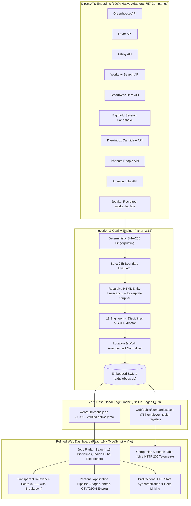

# JobOps ⚡ — Direct ATS Engineering Intelligence Radar

> **Production-grade, zero-cost engineering recruitment platform and intelligence radar.**  
> Ingests directly from **757+ verified tech employers and Fortune 500 companies** via native, unblocked ATS endpoints (Greenhouse, Lever, Ashby, Workday, SmartRecruiters, Eightfold, Darwinbox, Phenom, Amazon, Jobvite, etc.).  
> Enforces a **strict 24-hour freshness window**, filters tech roles via **multi-stage engineering taxonomy**, and delivers an elite, bespoke **Warm Charcoal & Crimson Burgundy design system**.

---

## 💎 Design Identity & Token Architecture

JobOps departs completely from generic, copy-paste AI templates and blue-and-white dashboards. It implements an authoritative, high-density Bloomberg/Stripe-caliber design token system tailored for serious engineers.

| Semantic Token | Hex Value | Purpose & Role | WCAG 2.1 Contrast |
|---|---|---|---|
| `--bg-main` | `#15120F` | Deep espresso dark base background canvas | Base Canvas |
| `--surface-primary` | `#211C18` | Standard card, panel, and sidebar container | 14.5:1 (Exceeds AAA) |
| `--surface-elevated` | `#28221C` | Elevated surfaces, dropdowns, modals, active pills | Structural Elevation |
| `--text-primary` | `#F4EEE5` | Warm ivory for primary job titles & high-contrast telemetry | 16.2:1 (Exceeds AAA) |
| `--text-secondary` | `#B9B0A5` | Sand taupe for company names, subheadings, labels | 7.8:1 (Exceeds AAA) |
| `--text-muted` | `#978B7B` | Muted taupe for timestamps, counts, subtle meta info | 4.9:1 (Passes AA/AAA) |
| `--border-color` | `#423A31` | Subtle hairline borders providing clean structural separation | Hairline Grid |
| `--action-primary` | `#A61921` | Signature crimson burgundy for primary actions & CTAs | 4.9:1 (Passes AA) |
| `--action-hover` | `#BD252D` | Vibrant crimson for interactive hover states | High-Affordance |
| `--accent-bg` | `#321416` | Wine-tinted container for 24h ultra-fresh badges | Freshness Pill |
| `--highlight-gold` | `#D1B56A` | Champagne gold for relevance score badges & telemetry | 8.6:1 (Exceeds AAA) |

### Typography System
- **UI & Body:** `Plus Jakarta Sans` — High x-height and open apertures optimized for dense technical scanning.
- **Brand & Headings:** `Lora` — Editorial serif imparting authoritative intelligence identity.
- **Telemetry & Badges:** `JetBrains Mono` — Monospaced precision for timestamps, YoE, ATS chips, and skill tags.

---

## 🏛️ System Architecture



---

## 🛡️ Zero-Cost / Zero-Infrastructure Guarantee (₹0.00 / $0.00 Forever)

JobOps eliminates recurring cloud infrastructure costs completely through a 3-tier architecture:

1. **Embedded Database (`data/jobops.db`):**
   - SQLite database stored directly inside the repository.
   - Zero AWS RDS bills, zero paid Supabase limits, zero Redis hosting charges.
2. **Global Edge Cache (`web/public/jobs.json` & `companies.json`):**
   - Ingestion pipeline exports active jobs and company telemetry into optimized static JSON caches.
   - Served globally via GitHub Pages with free SSL certificates, DDoS mitigation, and global CDN caching.
3. **Automated Scheduled Scraping (GitHub Actions):**
   - Cron workflows run every 2 hours on free GitHub Actions runners (`.github/workflows/scrape_jobs.yml`).
   - Automatically ingests new jobs, normalizes data, commits new snapshots, and deploys updates to GitHub Pages.

---

## 📊 13 Engineering Disciplines & Classification Taxonomy

JobOps automatically categorizes jobs into 13 disciplines, eliminating sales, marketing, and HR clutter:

1. **Backend & Systems:** Distributed systems, microservices, Go, Java, Python, C++, Rust, Node.js.
2. **Frontend & Web:** React, Vue, Angular, Next.js, TypeScript, CSS architecture, performance engineering.
3. **Full Stack Engineering:** End-to-end product development, web platforms.
4. **DevOps, SRE & Cloud:** Kubernetes, Docker, Terraform, AWS, GCP, CI/CD, reliability engineering.
5. **AI / ML / Data Science:** PyTorch, TensorFlow, LLMs, GenAI, MLOps, NLP, computer vision.
6. **Data Engineering:** Spark, Kafka, Airflow, Databricks, Snowflake, dbt, SQL pipelines.
7. **Mobile Engineering:** Android (Kotlin), iOS (Swift), React Native, Flutter.
8. **QA & SDET Automation:** Selenium, Playwright, Cypress, test automation frameworks.
9. **Cybersecurity & SecOps:** AppSec, DevSecOps, SOC, penetration testing, cryptography.
10. **Systems & Embedded:** Firmware, RTOS, IoT, hardware drivers, Linux kernel.
11. **Technical Product Management:** Tech PM, technical program management, engineering roadmaps.
12. **Staff+ & Systems Architecture:** Principal engineers, enterprise architects, staff engineers.
13. **Engineering Leadership:** Engineering managers, Directors, VP of Engineering, CTOs.

---

## 🎯 Transparent Relevance Score & Explainability

Unlike opaque black-box AI matchers, JobOps calculates a deterministic **0-100 Relevance Score** with complete transparency:
- **Base Engineering Verification:** `+50 pts` (Verified active engineering role).
- **24-Hour Ultra-Freshness:** `+20 pts` (Posted within strict 24-hour cycle).
- **Direct Title Match:** `+15 pts` (Direct match with candidate's search query).
- **Skill Alignment:** Up to `+15 pts` (`+5 pts` per matched selected skill tag).
- **Discipline Alignment:** `+5 pts` (Matches active selected filter discipline).

Hovering or clicking on any job's score badge reveals the exact calculation breakdown.

---

## 💼 Personal Job Pipeline & Workspace

JobOps includes a private, local-first candidate application tracker:
- **Pipeline Stages:** `Interested` ➔ `Saved` ➔ `Applied` ➔ `Interviewing` ➔ `Offer` ➔ `Rejected` ➔ `Archived`.
- **Private Notes:** Save salary expectations, recruiter contacts, and interview questions directly in your browser.
- **Application Dates:** Automatic tracking of date saved and date applied.
- **Data Ownership:** Export your entire pipeline with notes and links to **CSV spreadsheet** or **JSON** with one click.
- **100% Privacy:** All tracking data stays in your browser's `localStorage` — zero tracking or external logging.

---

## 🔒 Security & Data Integrity Invariants

- **Zero `dangerouslySetInnerHTML`:** 100% ban on raw HTML injection across all React components. External ATS feeds are treated as untrusted inputs.
- **Recursive Entity Sanitization:** Multi-pass unescaping decodes double-encoded HTML (`&amp;lt;div...`) and strips truncated tags before storage.
- **Protocol Whitelisting:** External application URLs are validated via `sanitizeExternalUrl()`; non-HTTP protocols (`javascript:`, `data:`, `file:`) are strictly blocked.
- **SSRF & Path Traversal Prevention:** The "Add ATS" submission form validates company slugs against `^[a-zA-Z0-9_-]{1,64}$`, forbidding slashes, dots, and query parameters.
- **URL Query Sanitization:** Deep-linked URL query parameters (`q`, `role`, `exp`, `city`, `mode`, `fresh`, `page`, `job`) are strictly validated against allowlists.

---

## 💻 Local Development & Execution

### 1. Ingestion Engine (Python 3.12)

```bash
# Clone the repository
git clone https://github.com/chandanvura/JobOps.git
cd JobOps

# Install Python requirements
pip install -r requirements.txt

# Run the full ingestion collector across all 757 companies
python -m engine.cli run

# Run automated test suite
python -m pytest tests/
```

### 2. Frontend Dashboard (React 19 + TypeScript + Vite)

```bash
cd web
npm install

# Start local dev server (port 3000)
npm run dev

# Run TypeScript compilation & production build
npm run build
```

---

## 📄 License

MIT License — 100% free for software engineers and community contributors.
